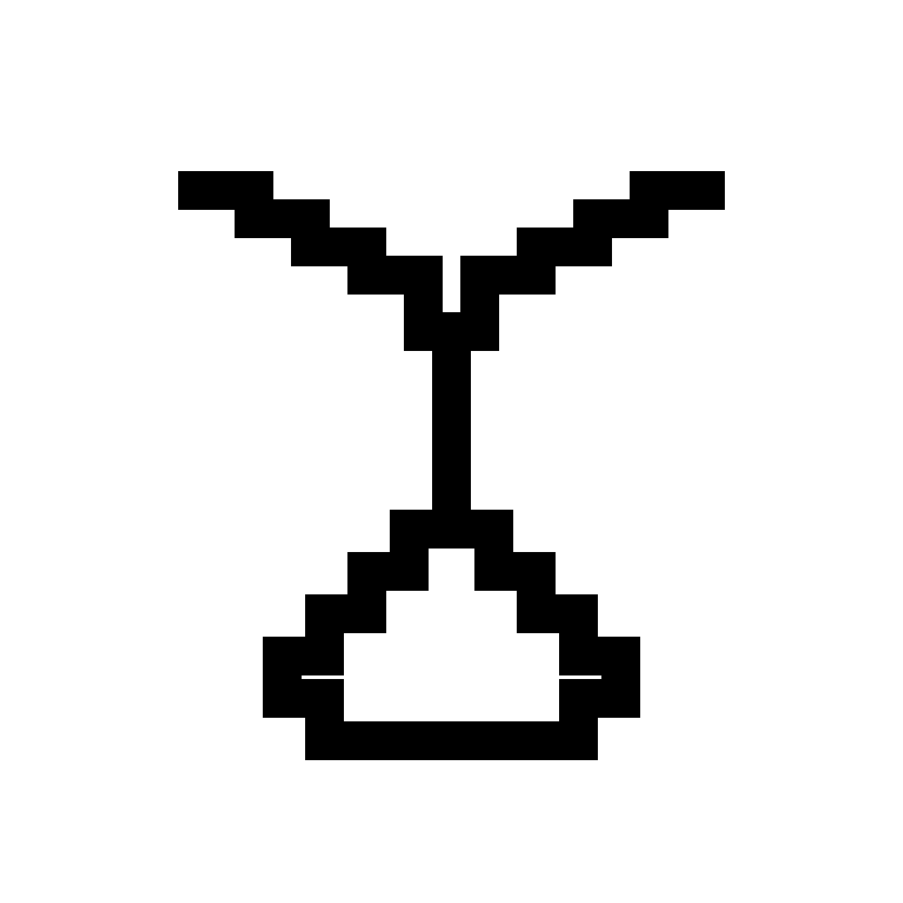

<div align="left">
    <picture>
        
    </picture>

<h1>YggdrasilManager</h1>


</div>

**English** | [繁體中文](README.zh-TW.md) | [简体中文](README.zh-CN.md)

An Android manager for the Yggdrasil KPM module, with a Compose interface and browser consoles for hardware breakpoints and arm64 syscall observation. It also manages debugger-state and memory-map policies and includes a standalone module self-test.

## Requirements

- An arm64 Android device running Android 7.0 / API 24 or later.
- Root access and a compatible Yggdrasil KPM module already loaded. The Manager does not install the kernel module.
- To build: JDK 21, Node.js 22 or later, and an Android SDK. Exact SDK, NDK and CMake versions are in the [build guide](docs/release/releasing.en.md#toolchain).

## Installation

Build a debug APK from source:

```sh
git clone https://github.com/ngiokweng/YggdrasilManager.git
cd YggdrasilManager
npm ci --prefix frontend
npm run sync:android --prefix frontend
bash ./gradlew :app:assembleDebug
```

`sync:android` replaces the bundled browser assets with the freshly built frontend. On Windows PowerShell, use `.\gradlew.bat :app:assembleDebug` for the last command.

Install the APK with Android platform tools:

```sh
adb install -r app/build/outputs/apk/debug/app-debug.apk
```

Debug uses the package `ng1ok.yggdrasilmanager.debug`, so it can coexist with the signed release package `ng1ok.yggdrasilmanager`. See [release builds and signing](docs/release/releasing.en.md) for production APKs.

## Configuration

Load the Yggdrasil module using your device's module tooling, open the Manager and grant Root access. The home screen reports the module status, Root status and Manager version separately.

The browser consoles have no authentication. Use them only on a trusted network and stop their servers when finished.

## Quick start

1. Confirm that the home screen reports the module as available and Root as granted.
2. Open **功能 → Arm64 Syscall Observe** or **HWBP Observe**.
3. Open the console URL shown on the phone in a browser on the same network. HWBP uses port `8765`; Syscall uses `8766`.

The [illustrated user guide](docs/user-guide/guide.en.md) walks through the four features with screenshots and short steps.

## What it does

- **Arm64 Syscall Observe**: intercept and rewrite syscalls, capture arguments and inspect events in the browser.
- **HWBP Observe**: configure hardware breakpoints and inspect hit events and backtraces.
- **Hide DBG**: manage debugger and stopped-state policies by application.
- **Hide Maps**: hide memory-map entries or rewrite their visible permissions.
- **Module self-test**: run the bundled arm64 executable through Root and inspect section results.

Available operations depend on the loaded module and the device.

## Documentation

- [Illustrated user guide](docs/user-guide/guide.en.md)
- [Build, signing, versioning and GitHub releases](docs/release/releasing.en.md)
- [Open-source readiness and remaining decisions](docs/release/open-source-readiness.en.md)
- [Browser-console development](docs/development/frontend.en.md)
- [Changelog](docs/release/changelog.en.md)

## Testing

```sh
node --test scripts/test/*.test.mjs
npm test --prefix frontend
npm audit --prefix frontend --audit-level=high
bash ./gradlew :app:testDebugUnitTest :app:lintDebug
```

CI also rebuilds the browser assets and compiles both APK variants. Its release build uses a disposable key; version-tag releases use the private release key and verify the resulting certificate before publication.

## Credits

Native backtraces use the vendored `libunwindstack-ndk`; Root operations use `libsu`. See [third-party components](docs/project/credits.en.md) for their origins and preserved license notices.

A project-wide license still needs to be selected before the repository is presented as open source; see the [remaining decisions](docs/release/open-source-readiness.en.md).
