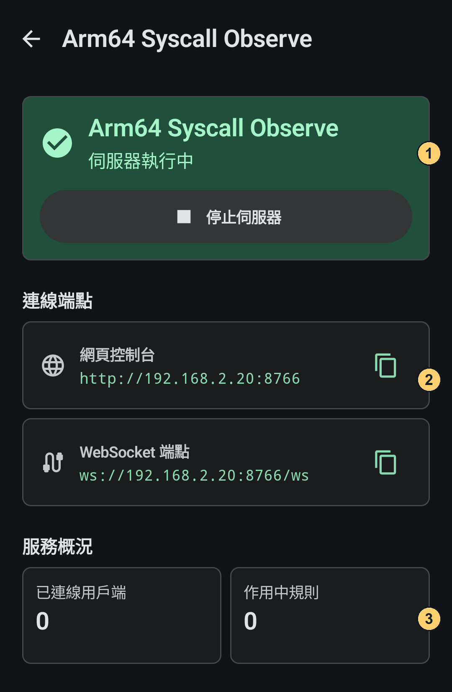
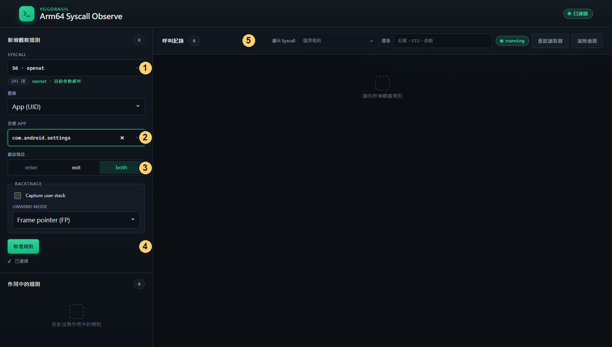
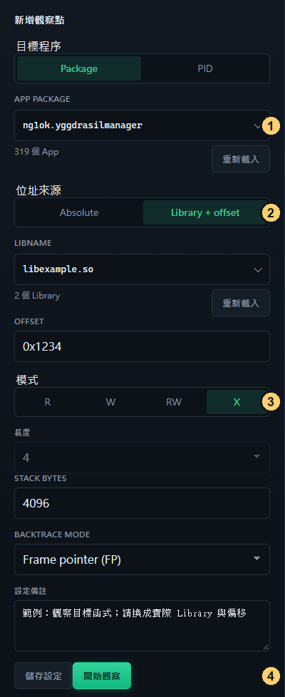
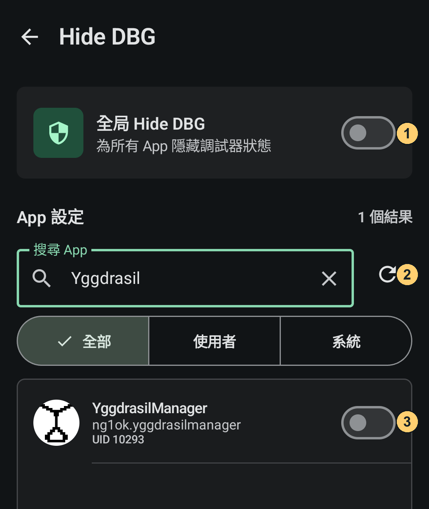
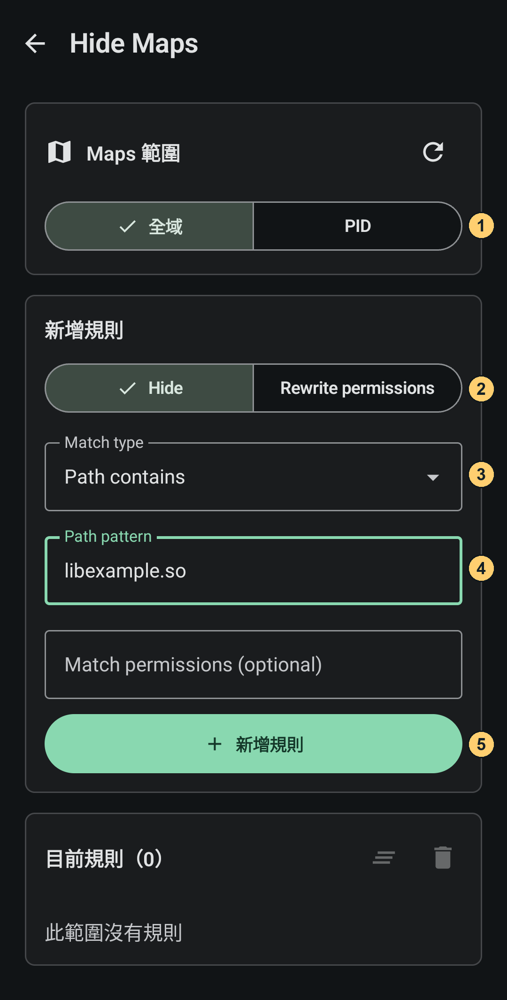

# YggdrasilManager user guide

**English** | [繁體中文](guide.zh-TW.md) | [简体中文](guide.zh-CN.md)

YggdrasilManager provides four tools:

| Tool | What it does |
| --- | --- |
| **Arm64 Syscall Observe** | See which system interfaces an app calls, such as opening files or reading data |
| **HWBP Observe** | Observe when a memory address is read, written or executed |
| **Hide DBG** | Hide debugger and stopped-state information in process status |
| **Hide Maps** | Hide memory-map entries or change their displayed permissions |

Before starting, confirm that the phone has Root access and the Yggdrasil module is loaded. Open the app: the home screen should show Yggdrasil as **可用** (available) and Root as **已授權** (granted), then select **功能** (features) at the bottom. The UI labels and screenshots use Chinese; the explanations below identify the corresponding controls.

## Which tools need a computer?

**Syscall Observe and HWBP Observe are operated through a web page**; a desktop browser is recommended. Both connect in the same way:

1. Connect the phone and computer to the same Wi-Fi network.
2. Open the corresponding tool on the phone and confirm that the server is running. Start it if it has stopped.
3. In the computer's browser, open the **網頁控制台** (web console) address shown on the phone. Wait for **已連線** (connected).

In the image, ① is the server status and ② is the address to open in the browser. Syscall uses port `8766` and HWBP uses `8765`; use the address actually shown on your phone.

Keep the phone on that tool's screen while working; navigating back stops the web server. **Hide DBG and Hide Maps are operated directly on the phone**.

## 1. Syscall Observe: inspect an app's system calls

**When to use it**: for example, to find out whether an app opens a particular file, observe the `openat` system call.

Follow this example:

1. Open **功能 → Arm64 Syscall Observe** on the phone and open its console on the computer.
2. Search for `openat` in the web console's **Syscall** picker and select **56 · openat**.
3. Set the scope to **App (UID)**, then search for and select the target app in the target-app picker.
4. Set the observation phase to **both** and leave the other settings at their defaults.
5. Click **新增規則** (add rule) and confirm that the rule appears in the list on the left.
6. Perform the relevant action in the target app, then inspect the call records on the right. Expand a record to see its arguments and return value.

Markers ① through ⑤ identify the syscall, target app, observation phase, add button and record area. The screenshot has no rule added yet, so the records are empty.

**When finished**: click **移除** (remove) next to the rule on the left. To inspect a different syscall, change the selection in step 2.

## 2. HWBP Observe: observe a memory address

**When to use it**: you know the address of a function or data item and want to see when it is executed, read or modified.

You need either the target address or the target `.so` library's name and an offset.

To observe execution of a function:

1. Start the target app, open **功能 → HWBP Observe** on the phone, then open its console on the computer.
2. Set the target program to **Package**, then search for and select the target app.
3. Set the address source to **Library + offset**. Enter the library in **Libname** and the offset in **Offset**, for example `0x1234`.
4. Set the mode to **X** to observe execution and leave the other settings at their defaults.
5. Click **開始觀察** (start observing) and confirm that the entry appears in the active observation points.
6. Trigger the relevant behavior in the target app, then inspect the hit events in the web console. Expand an event's **Backtrace** to see the call origin.

Markers ① through ④ identify the target app, address source, mode and start button. `libexample.so` and `0x1234` are examples: replace them with real values, and ensure that the target library is loaded.

The modes are **R = read, W = write, RW = read or write, X = execute**. If you already have a full memory address, select **Absolute** in step 3 and fill in **Address**.

**When finished**: click **移除** (remove) next to the active observation point. To reuse the configuration later, save it first; after restarting the target app, apply the saved configuration.

## 3. Hide DBG: hide debugger state

**When to use it**: while debugging an app, hide debugger traces in process status information, such as `TracerPid`. The effect depends on what the app checks.

To enable it for one app:

1. Open **功能 → Hide DBG**.
2. Leave the global Hide DBG switch at the top off.
3. Search for the app, confirm its label and package name, then turn on its switch on the right.
4. Wait for the operation to finish, then retry in the target app.

Markers ① through ③ identify the global switch, search area and per-app switch. To enable it for every app, turn on the global switch instead.

**When finished**: turn off the relevant switch. After turning off global mode, select individual apps again if you still want it enabled for some of them. Apps marked as sharing a UID are affected together.

After rebooting the phone or reloading the module, toggle the settings again to reapply them.

## 4. Hide Maps: hide memory-map information

**When to use it**: hide a `.so` library from the process's memory-map listing, or change the read/write/execute permissions displayed in that listing.

To hide a library's map entries:

1. Open **功能 → Hide Maps**.
2. Set the Maps scope to **PID**, enter the target process's PID and refresh using the button at the top right. Use the global scope only when the rule should affect every process.
3. Set the action to **Hide**.
4. Set **Match type** to **Path contains**.
5. In **Path pattern**, enter the library name to hide, for example `libexample.so`. Leave permission conditions empty initially.
6. Click **新增規則** (add rule) and confirm that the rule appears in the list below.

Markers ① through ⑤ identify the scope, action, match type, path and add button. The screenshot uses global scope; for one process, follow step 2 and select PID.

If you do not know the PID, run `adb shell pidof PACKAGE_NAME` on the computer, replacing `PACKAGE_NAME` with the app's package name. The app must already be running.

To **change the displayed permissions**, select **Rewrite permissions**, enter `r--` (read only) or `rw-` (read/write) in **Set permissions**, then add the rule. This changes the displayed information, not the actual memory permissions.

**When finished**: click the trash icon next to the rule. If the effect remains after deleting a PID rule, check for global rules as well.

## Two things to remember when finished

- **Syscall / HWBP**: remove rules or observation points in the web console before stopping the phone's server. Stopping the server, closing the page or clearing the display does not remove active observations.
- **No records**: confirm that the target app is running and the rule has been added, then perform an action that triggers the observation condition.
