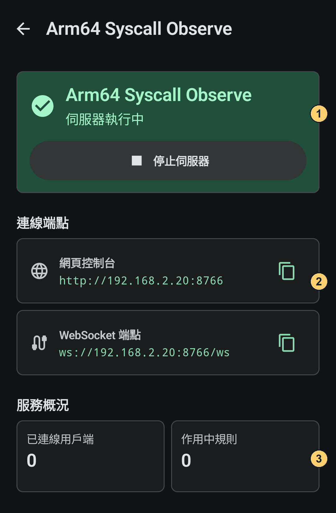
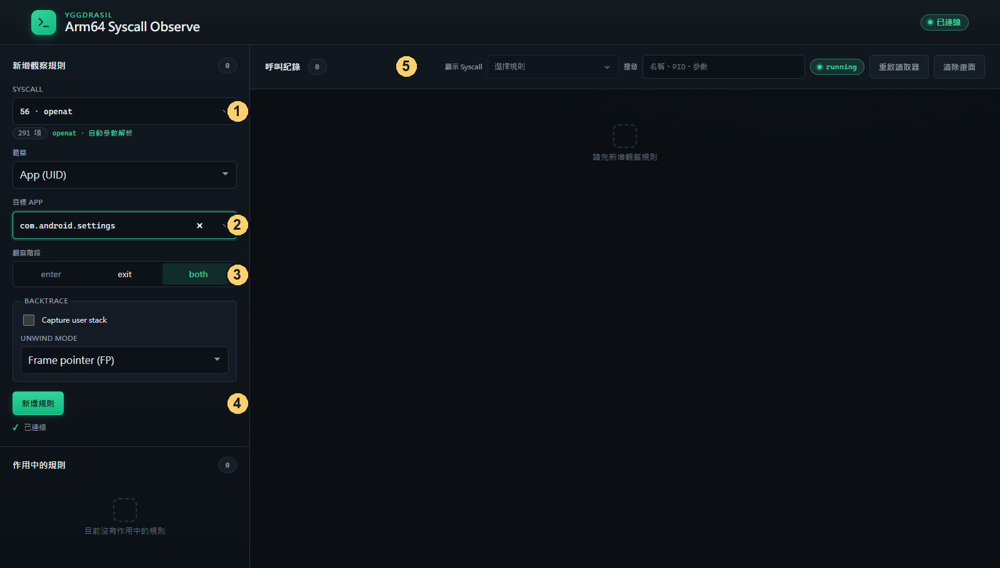
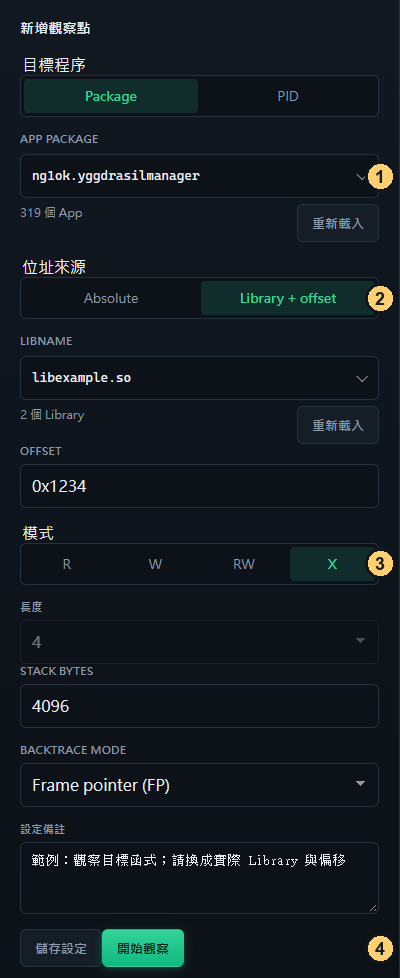
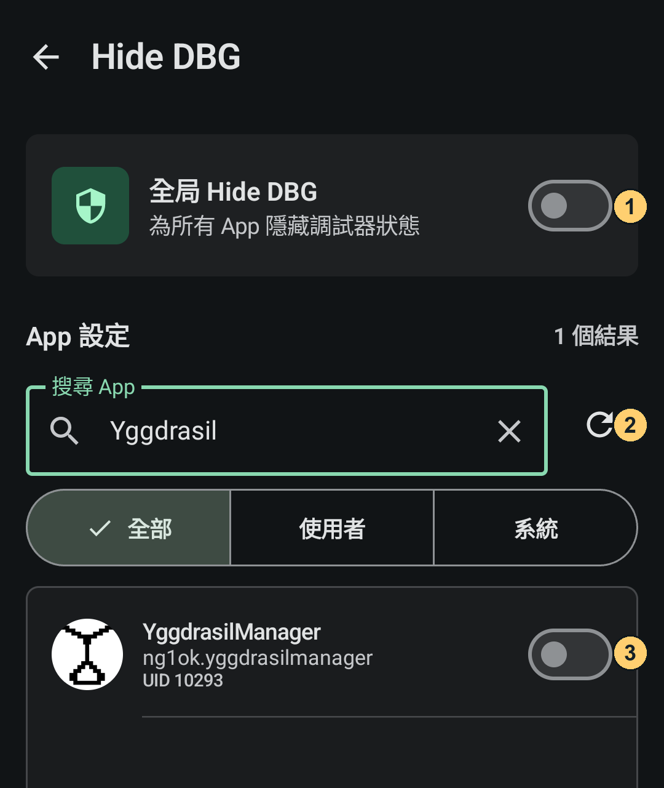
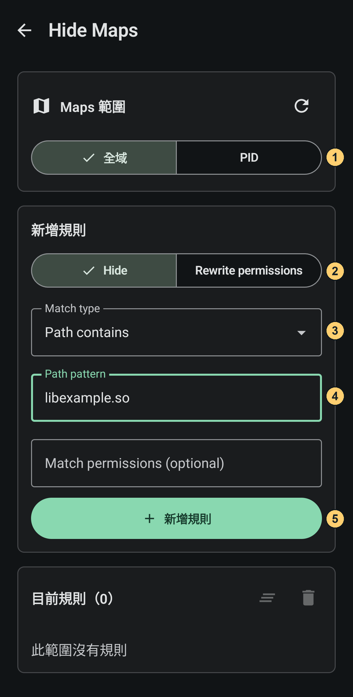

# YggdrasilManager 使用指南

[English](guide.en.md) | [繁體中文](guide.zh-TW.md) | **简体中文**

YggdrasilManager 提供四个功能：

| 功能 | 用来做什么 |
| --- | --- |
| **Arm64 Syscall Observe** | 查看应用调用了哪些系统接口，例如打开文件、读取数据 |
| **HWBP Observe** | 观察某个内存地址什么时候被读取、写入或执行 |
| **Hide DBG** | 隐藏进程信息中的调试器和停止状态 |
| **Hide Maps** | 隐藏内存映射记录，或修改记录显示的权限 |

使用前，先确认手机已获得 Root 权限、Yggdrasil 模块已加载。打开 App，主页应显示 Yggdrasil “**可用**”、Root “**已授权**”，然后点击底部的“**功能**”。

## 先了解：哪些功能需要电脑？

**Syscall Observe 和 HWBP Observe 在网页里操作**，建议用电脑浏览器。连接方法相同：

1. 手机和电脑连接同一个 Wi-Fi。
2. 在手机进入对应功能，确认显示“服务器运行中”；如果已停止，点击启动按钮。
3. 在电脑浏览器输入手机页面上的“**网页控制台**”地址，等网页显示“**已连接**”。

图中 ① 是服务状态，② 是要在浏览器打开的地址。Syscall 使用端口 `8766`，HWBP 使用 `8765`，以手机显示的地址为准。

操作时让手机停留在该功能页；按返回离开会停止网页服务。**Hide DBG 和 Hide Maps 直接在手机里操作**。

## 1. Syscall Observe：查看应用的系统调用

**适合做什么**：比如想知道应用有没有打开某个文件，可以观察 `openat` 这个系统调用。

按下面的例子操作：

1. 在手机进入 **功能 → Arm64 Syscall Observe**，用电脑打开控制台。
2. 在网页的 **Syscall** 中搜索 `openat`，选中 **56 · openat**。
3. **范围** 选 **App (UID)**，在 **目标 App** 中搜索并点选要观察的应用。
4. **观察阶段** 选 **both**，其他设置先保持默认。
5. 点击 **新增规则**，确认它出现在左侧的规则列表中。
6. 在目标应用里做一次相关操作，再到网页右侧的 **调用记录** 查看结果。点开记录，可以看参数和返回值。

图中 ① 到 ⑤ 分别对应系统调用、目标应用、观察阶段、新增按钮和记录区。截图还没有新增规则，所以记录为空。

**用完怎么关**：在左侧规则旁点击 **移除**。想查其他系统调用时，更换第 2 步的选项即可。

## 2. HWBP Observe：观察指定内存地址

**适合做什么**：已经知道某个函数或数据的地址，想看它什么时候被执行、读取或修改。

使用这个功能，需要先知道目标地址，或者目标 `.so` 库的名称和偏移。

以“观察某个函数被执行”为例：

1. 先启动目标应用，再进入手机的 **功能 → HWBP Observe**，用电脑打开控制台。
2. **目标程序** 选 **Package**，搜索并点选目标应用。
3. **地址来源** 选 **Library + offset**，在 **Libname** 填库名，在 **Offset** 填偏移，例如 `0x1234`。
4. **模式** 选 **X**，表示观察执行；其他设置先保持默认。
5. 点击 **开始观察**，确认它出现在 **作用中的观察点** 列表里。
6. 在目标应用里触发相关功能，再到网页的 **命中事件** 查看结果。展开事件里的 **Backtrace**，可以看调用来源。

图中 ① 是目标应用，② 是地址来源，③ 是模式，④ 是开始按钮。`libexample.so` 和 `0x1234` 只是示例，必须换成实际值，且目标库需要已加载。

模式只需记住：**R = 读，W = 写，RW = 读或写，X = 执行**。如果已有完整内存地址，第 3 步改选 **Absolute**，填写 **Address**。

**用完怎么关**：在 **作用中的观察点** 旁点击 **移除**。想下次重用，可以先点 **保存设置**；以后启动目标应用后，再对保存的设置点 **套用**。

## 3. Hide DBG：隐藏调试状态

**适合做什么**：调试应用时，隐藏进程状态信息中显示的调试器痕迹，例如 `TracerPid`。效果取决于应用检查的内容。

只对某个应用开启：

1. 进入 **功能 → Hide DBG**。
2. 保持上方 **全局 Hide DBG** 关闭。
3. 搜索目标应用，核对名称和包名，打开该应用右侧的开关。
4. 等待开关操作完成，再到目标应用里重试。

图中 ① 是全局开关，② 是搜索区域，③ 是单个应用的开关。要对所有应用开启，直接打开全局开关。

**用完怎么关**：关闭对应开关。关闭全局模式后，如果还想对部分应用开启，需要重新选择。标有 **共享 UID** 的应用会一起受影响。

手机重启或模块重新加载后，需要重新开关一次才能再次应用设置。

## 4. Hide Maps：隐藏内存映射信息

**适合做什么**：让程序的内存映射列表不再显示某个 `.so` 库，或改变列表中显示的读写执行权限。

以“隐藏某个库的映射记录”为例：

1. 进入 **功能 → Hide Maps**。
2. **Maps 范围** 选 **PID**，填入目标进程的 PID，再点右上角刷新。要对所有进程生效，才选 **全局**。
3. 动作选 **Hide**。
4. **Match type** 选 **Path contains**，意思是“路径包含”。
5. **Path pattern** 填要隐藏的库名，例如 `libexample.so`；权限条件先留空。
6. 点击 **新增规则**，确认下方列表出现该规则。

图中 ① 到 ⑤ 依次是范围、动作、匹配方式、路径和新增按钮。截图选的是全局；只处理一个进程时，按第 2 步改选 PID。

不知道 PID 时，可以在电脑用 `adb shell pidof PACKAGE_NAME` 查询，将 `PACKAGE_NAME` 换成应用的包名；应用需要先启动。

如果想**修改显示的权限**，把动作改成 **Rewrite permissions**，在 **Set permissions** 填 `r--`（只读）或 `rw-`（读写），再新增规则。它修改的是显示内容，实际内存权限不会改变。

**用完怎么关**：在规则列表中点击对应条目的垃圾桶。删除 PID 规则后如果效果仍在，再检查全局是否也有规则。

## 用完后记住这两件事

- **Syscall / HWBP**：先在网页移除规则或观察点，再停止手机端服务器。停止服务器、关闭网页或点击“清除画面”，都不会移除已经启用的观察。
- **没有记录时**：先确认目标应用已启动、规则已添加，再做一次会触发观察条件的操作。
