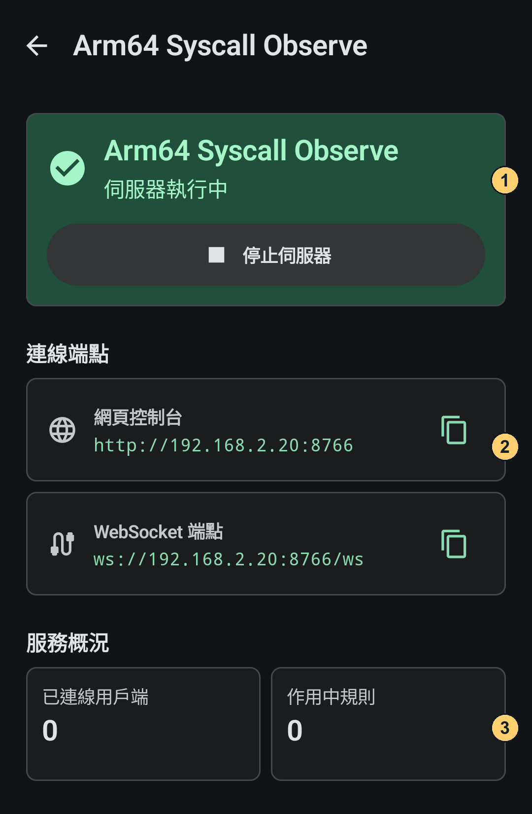
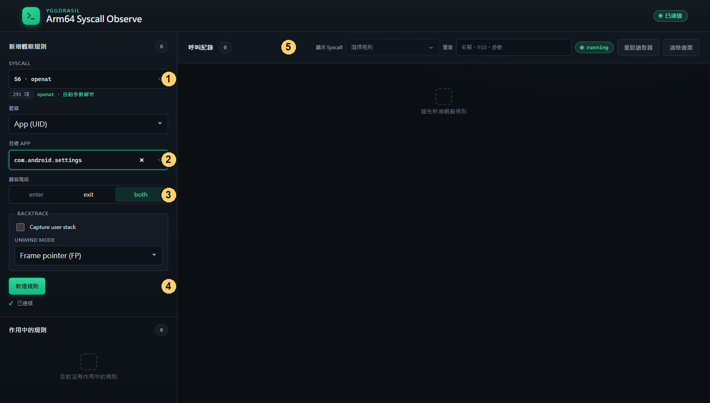
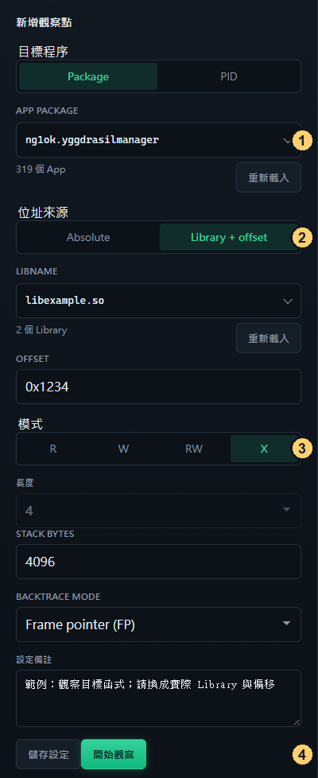
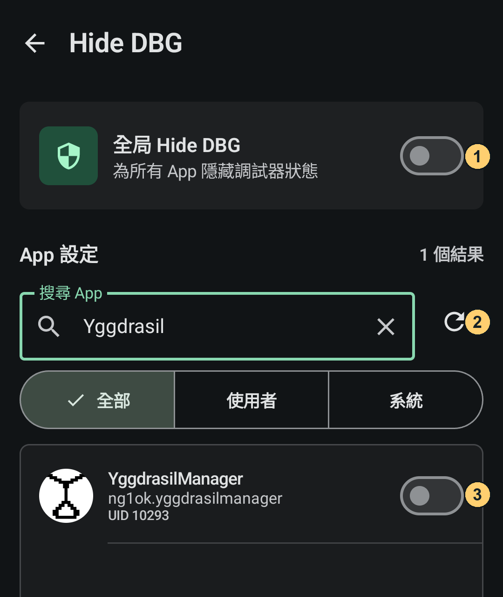
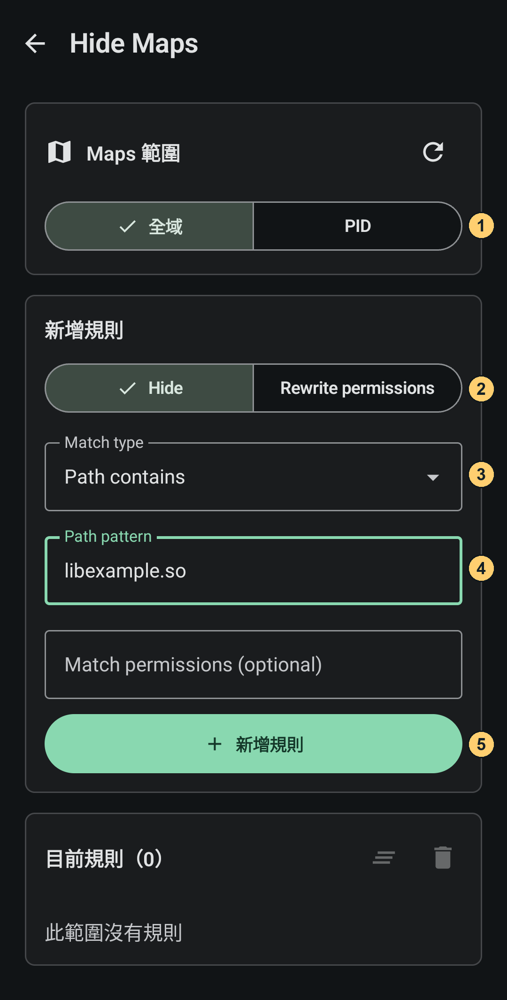

# YggdrasilManager 使用指南

[English](guide.en.md) | **繁體中文** | [简体中文](guide.zh-CN.md)

YggdrasilManager 提供四項功能：

| 功能 | 用來做什麼 |
| --- | --- |
| **Arm64 Syscall Observe** | 查看應用程式呼叫了哪些系統介面，例如開啟檔案、讀取資料 |
| **HWBP Observe** | 觀察某個記憶體位址何時被讀取、寫入或執行 |
| **Hide DBG** | 隱藏行程資訊中的偵錯器與停止狀態 |
| **Hide Maps** | 隱藏記憶體映射紀錄，或修改紀錄顯示的權限 |

使用前，先確認手機已取得 Root 權限、Yggdrasil 模組已載入。開啟 App，首頁應顯示 Yggdrasil「**可用**」、Root「**已授權**」，再點底部的「**功能**」。

## 先了解：哪些功能需要電腦？

**Syscall Observe 和 HWBP Observe 在網頁中操作**，建議使用電腦瀏覽器。兩者的連線方法相同：

1. 手機與電腦連接同一個 Wi-Fi。
2. 在手機進入對應功能，確認顯示「伺服器運行中」；若已停止，點啟動按鈕。
3. 在電腦瀏覽器輸入手機頁面上的「**網頁控制台**」網址，等網頁顯示「**已連線**」。

圖中 ① 是服務狀態，② 是要在瀏覽器開啟的網址。Syscall 使用連接埠 `8766`，HWBP 使用 `8765`，以手機顯示的網址為準。

操作時讓手機停留在該功能頁；按返回離開會停止網頁服務。**Hide DBG 和 Hide Maps 直接在手機操作**。

## 1. Syscall Observe：查看應用程式的系統呼叫

**適合做什麼**：例如想知道應用程式是否開啟了某個檔案，可以觀察 `openat` 系統呼叫。

依照以下例子操作：

1. 在手機進入 **功能 → Arm64 Syscall Observe**，用電腦開啟控制台。
2. 在網頁的 **Syscall** 中搜尋 `openat`，選取 **56 · openat**。
3. **範圍** 選 **App (UID)**，在 **目標 App** 中搜尋並點選要觀察的應用程式。
4. **觀察階段** 選 **both**，其他設定先保留預設值。
5. 點 **新增規則**，確認它出現在左側的規則清單。
6. 在目標應用程式執行一次相關操作，再到網頁右側的 **呼叫紀錄** 查看結果。展開紀錄，可查看引數與回傳值。

圖中 ① 至 ⑤ 分別對應系統呼叫、目標應用程式、觀察階段、新增按鈕與紀錄區。截圖尚未新增規則，因此紀錄為空。

**用完怎麼關**：在左側規則旁點 **移除**。想查其他系統呼叫時，更換第 2 步的選項即可。

## 2. HWBP Observe：觀察指定記憶體位址

**適合做什麼**：已知某個函式或資料的位址，想看它何時被執行、讀取或修改。

使用這項功能，需要先知道目標位址，或目標 `.so` 函式庫的名稱與偏移。

以「觀察某個函式被執行」為例：

1. 先啟動目標應用程式，再進入手機的 **功能 → HWBP Observe**，用電腦開啟控制台。
2. **目標程式** 選 **Package**，搜尋並點選目標應用程式。
3. **位址來源** 選 **Library + offset**，在 **Libname** 填函式庫名稱，在 **Offset** 填偏移，例如 `0x1234`。
4. **模式** 選 **X**，表示觀察執行；其他設定先保留預設值。
5. 點 **開始觀察**，確認它出現在 **作用中的觀察點** 清單。
6. 在目標應用程式觸發相關功能，再到網頁的 **命中事件** 查看結果。展開事件中的 **Backtrace**，可查看呼叫來源。

圖中 ① 是目標應用程式，② 是位址來源，③ 是模式，④ 是開始按鈕。`libexample.so` 和 `0x1234` 僅為範例，請換成實際值，且目標函式庫必須已載入。

模式只需記住：**R = 讀，W = 寫，RW = 讀或寫，X = 執行**。若已有完整記憶體位址，第 3 步改選 **Absolute**，填寫 **Address**。

**用完怎麼關**：在 **作用中的觀察點** 旁點 **移除**。想下次重用，可先點 **儲存設定**；之後啟動目標應用程式，再對儲存的設定點 **套用**。

## 3. Hide DBG：隱藏偵錯狀態

**適合做什麼**：偵錯應用程式時，隱藏行程狀態資訊中的偵錯器痕跡，例如 `TracerPid`。效果取決於應用程式檢查的內容。

只對某個應用程式啟用：

1. 進入 **功能 → Hide DBG**。
2. 保持上方 **全域 Hide DBG** 關閉。
3. 搜尋應用程式，核對名稱與套件名稱，開啟該應用程式右側的開關。
4. 等待操作完成，再到目標應用程式重試。

圖中 ① 是全域開關，② 是搜尋區域，③ 是個別應用程式的開關。要對所有應用程式啟用，直接開啟全域開關。

**用完怎麼關**：關閉對應開關。關閉全域模式後，若仍想對部分應用程式啟用，需要重新選擇。標有 **共用 UID** 的應用程式會一同受影響。

手機重新啟動或模組重新載入後，需要重新切換開關，才會再次套用設定。

## 4. Hide Maps：隱藏記憶體映射資訊

**適合做什麼**：讓行程的記憶體映射清單不再顯示某個 `.so` 函式庫，或改變清單中顯示的讀寫執行權限。

以「隱藏某個函式庫的映射紀錄」為例：

1. 進入 **功能 → Hide Maps**。
2. **Maps 範圍** 選 **PID**，填入目標行程的 PID，再點右上角重新整理。要對所有行程生效時，才選 **全域**。
3. 動作選 **Hide**。
4. **Match type** 選 **Path contains**，表示「路徑包含」。
5. **Path pattern** 填要隱藏的函式庫名稱，例如 `libexample.so`；權限條件先留空。
6. 點 **新增規則**，確認下方清單出現該規則。

圖中 ① 至 ⑤ 依序是範圍、動作、比對方式、路徑與新增按鈕。截圖選的是全域；只處理一個行程時，請依第 2 步改選 PID。

不知道 PID 時，可在電腦用 `adb shell pidof PACKAGE_NAME` 查詢，將 `PACKAGE_NAME` 換成應用程式的套件名稱；應用程式必須先啟動。

若想**修改顯示的權限**，將動作改為 **Rewrite permissions**，在 **Set permissions** 填 `r--`（唯讀）或 `rw-`（讀寫），再新增規則。它修改的是顯示內容，實際記憶體權限不會改變。

**用完怎麼關**：在規則清單中點對應項目的垃圾桶。刪除 PID 規則後若效果仍在，再檢查是否有全域規則。

## 用完後記住這兩件事

- **Syscall / HWBP**：先在網頁移除規則或觀察點，再停止手機端伺服器。停止伺服器、關閉網頁或點「清除畫面」，都不會移除已啟用的觀察。
- **沒有紀錄時**：先確認目標應用程式已啟動、規則已新增，再執行一次會觸發觀察條件的操作。
